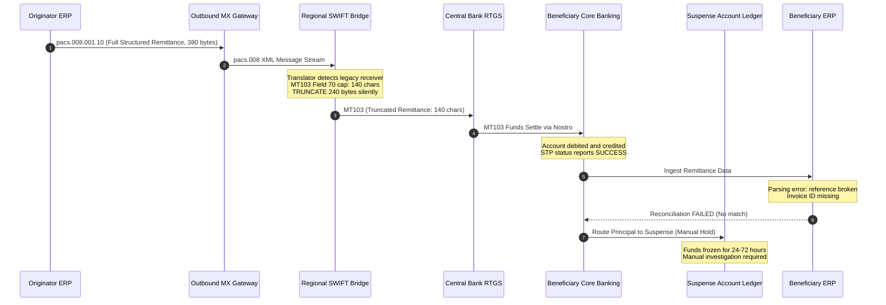
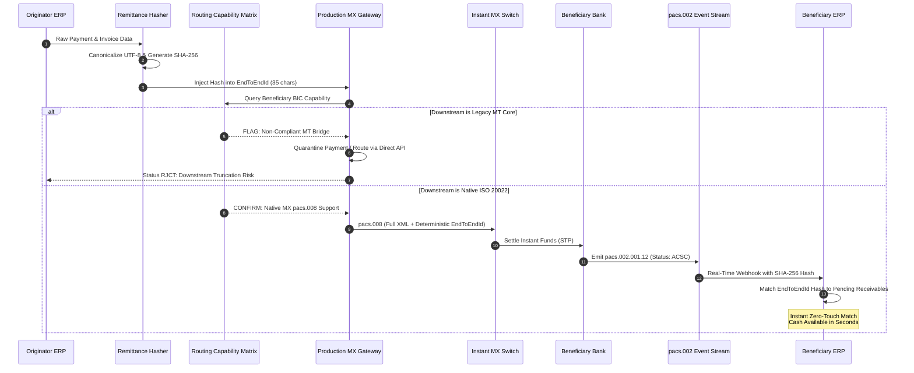
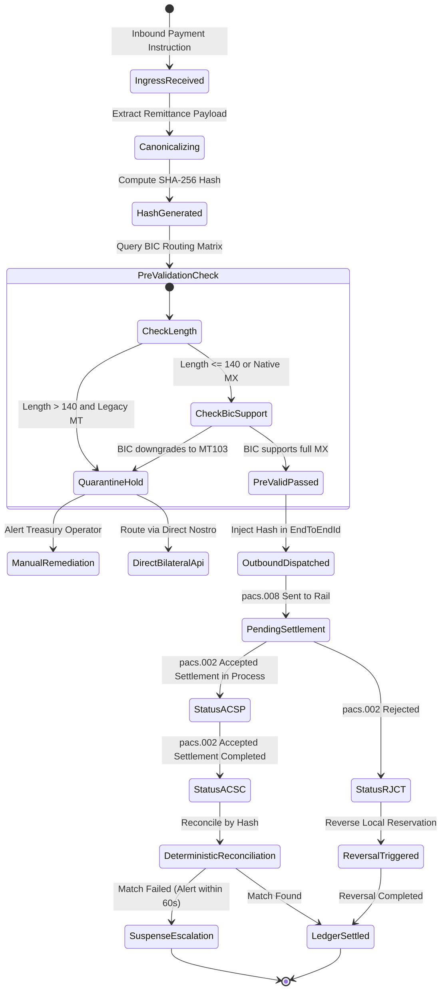

<div class="my-8 overflow-hidden rounded-2xl border border-white/10 bg-[var(--surface-card)] p-3 sm:p-5 shadow-2xl" dir="ltr">
  
</div>

<div class="my-6 p-4 rounded-xl border border-[var(--border)] bg-[var(--surface-sunken)] flex flex-col sm:flex-row items-center justify-between gap-4 font-mono text-xs">
  <div>
    <span class="text-[var(--accent-primary)] font-bold uppercase tracking-wider block mb-1">Interactive Research Artifacts</span>
    <span class="text-[var(--text-secondary)]">Download vector PDF carousel and review engineering benchmarks.</span>
  </div>
  <div class="flex items-center gap-3">
    <a href="/stories/carousels/the-iso20022-truncation-trap-carousel.pdf" target="_blank" class="px-3 py-1.5 rounded bg-[var(--surface-card)] border border-[var(--border)] text-[var(--text-primary)] hover:border-[var(--accent-primary)] transition-all flex items-center gap-1.5">
      <span>Download PDF Carousel</span> &darr;
    </a>
  </div>
</div>

---

**Document ID:** WP-FIN-2026-001  
**Classification:** Financial Infrastructure & Protocol Engineering  
**Target Systems:** SWIFT CBPR+, FedNow, SEPA Instant, UAE Aani, RTGS Core Translators  
**Author:** Ariya Sarrafzadeh | Solutions Architect & Technical Product Owner  

 - -

## 1. Executive Summary & Problem Scope

Global payment networks are executing a multi-year migration from legacy SWIFT MT formats to rich ISO 20022 MX (XML) schemas. In our audits, we've found financial institutions operating in a hybrid environment where upstream originators emit ISO 20022 `pacs.008.001.10` messages, but downstream correspondent nodes or regional clearing networks continue to process legacy SWIFT MT103 message frames.

This mismatch introduces an asynchronous data loss vulnerability: the silent truncation of structured remittance information at translator gateways.

```
+-------------------+       +--------------------+       +-----------------------+
| Originator System | ----> | Translator Gateway | ----> | Correspondent Network |
|  pacs.008 (XML)   |       |  SWIFT MT/MX RFC   |       |      MT103 Flat       |
+-------------------+       +--------------------+       +-----------------------+
  Structured Remittance       Field 70: 4x35 bytes         Silent Truncation
  Infinite Depth              Total 140 Chars Max          STP Succeeded
                                                           Reconciliation Failed
```

When you downgrade an ISO 20022 XML tree to an MT103 message, the translator encounters the hard capacity limits of MT103 Field 70 (`Remittance Information`). While the XML source schema allows extensive remittance structures with arbitrary invoice lines, tax references, and creditor identifiers, MT103 Field 70 is restricted to a maximum of 4 lines of 35 characters each (140 characters total).

We've watched intermediate gateways silently truncate data exceeding 140 characters to prevent parser rejection and avoid broken Straight-Through Processing (STP). Your wire clears the central bank switch, your dashboard turns green, but you've lost the remittance references. Real-Time Gross Settlement (RTGS) switch. The funds arrive at the beneficiary bank. However, the structured invoice metadata required by enterprise resource planning (ERP) systems is stripped. The incoming credit can't be matched automatically. Your funds get diverted into internal suspense accounts, requiring manual investigation and delaying corporate liquidity for up to 72 hours.

 - -

## 2. Downward Translation Architecture & SWIFT CBPR+ Specifications

The SWIFT Cross-Border Payments and Reporting Plus (CBPR+) specification governs the conversion between ISO 20022 and MT message formats.

### 2.1 Structural Mismatch: Hierarchical MX vs Flat MT

| Dimension | ISO 20022 `pacs.008.001.10` | SWIFT MT103 |
| : - - | : - - | : - - |
| **Data Model** | Typed hierarchical XML schema | Flat ASCII tagged fields |
| **Remittance Container** | `<RmtInf><Strd>...</Strd></RmtInf>` | Field 70 (`:70:`) |
| **Max Capacity** | Practically unconstrained (KB range) | 4 lines x 35 characters (140 characters) |
| **Character Set** | UTF-8 (Extended international characters) | SWIFT X-Character Set (Strict ASCII subset) |
| **Referred Document** | `<RfrdDocInf><Nb>...</Nb></RfrdDocInf>` | Merged into unstructured text lines |
| **Tax Information** | `<TaxRmt><RcptId>...</TaxRmt>` | Dropped or truncated |
| **Creditor Reference** | ISO 11649 Structured Reference (`<CdtrRefInf>`) | Often mangled by line wrapping |

### 2.2 Translation RFC Mapping Algorithm

When we look at standard translation algorithms (e.g., SWIFT CBPR+ Translation Rules), the converter executes the following pseudocode:

```
function mapRemittance(pacs008Message):
    lines = []
    for strd in pacs008Message.CreditTransferTransactionInformation.RemittanceInformation.Structured:
        if strd.ReferredDocumentInformation exists:
            lines.append("INV/" + strd.ReferredDocumentInformation.Number)
        if strd.CreditorReferenceInformation exists:
            lines.append("REF/" + strd.CreditorReferenceInformation.Reference)
        if strd.AdditionalRemittanceInformation exists:
            for addtl in strd.AdditionalRemittanceInformation:
                lines.append("TXT/" + addtl)
    
    // Flatten and enforce MT103 Field 70 boundary
    flatText = join(lines, "/")
    field70Lines = splitIntoChunks(flatText, maxLineLength=35, maxLines=4)
    
    if flatText.length > 140:
        logWarning("Remittance data truncated: original=" + flatText.length + " bytes")
        // SILENT TRUNCATION OCCURS HERE
        return field70Lines.slice(0, 4)
    
    return field70Lines
```

Because the translation rules mandate successful transport over data preservation, the translator emits a valid MT103 payload. The messaging network considers the transaction valid. The application layer above the network loses its critical linkage.

 - -

## 3. Mathematical Model of Truncation & Collision Probability

### 3.1 Truncation Probability

Let $L$ be a random variable representing the total length of a serialized structured remittance block in characters. Let $N$ denote the number of line items or referenced documents in an invoice batch, and let $X_i$ represent the character length of the $i$-th component:

$$L = \sum_{i=1}^{N} X_i + (N - 1) C_{sep}$$

Where $C_{sep}$ is the delimiter overhead per field. Assuming $X_i$ are independent and identically distributed with mean $\mu_X$ and variance $\sigma_X^2$, and $N$ follows a discrete distribution with mean $\mu_N$ and variance $\sigma_N^2$:

$$\mathbb{E}[L] = \mu_N \mu_X + (\mu_N - 1) C_{sep}$$

$$\operatorname{Var}(L) = \mu_N \sigma_X^2 + \mu_X^2 \sigma_N^2$$

By the Central Limit Theorem for random sums, for corporate billing volumes $L$ can be approximated as normally distributed $\mathcal{N}(\mu_L, \sigma_L^2)$.

The probability of silent truncation $P_{\text{trunc}}$ across a legacy bridge is given by:

$$P_{\text{trunc}} = \mathbb{P}(L > 140) = 1 - \Phi\left(\frac{140 - \mu_L}{\sigma_L}\right) = \frac{1}{2} \operatorname{erfc}\left(\frac{140 - \mu_L}{\sigma_L \sqrt{2}}\right)$$

Where $\Phi(z)$ is the cumulative distribution function of the standard normal distribution and $\operatorname{erfc}(z)$ is the complementary error function.

In empirical corporate banking datasets where an enterprise wire contains an average of 3.2 line references ($\mu_L = 192$ characters, $\sigma_L = 38$ characters):

$$z = \frac{140 - 192}{38} = \frac{-52}{38} \approx -1.368$$

$$P_{\text{trunc}} = 1 - \Phi(-1.368) = \Phi(1.368) \approx 0.9144 \quad (91.4\%)$$

Over 91% of multi-item structured corporate payment instructions suffer data truncation when mapped to MT103 Field 70.

### 3.2 Reference Identifier Collision Under Prefix Truncation

When an invoice identifier string $I \in \Sigma^*$ is truncated to a prefix length $k \le 140$, the entropy of the identifier collapses. If an enterprise emits $M$ payments in a billing cycle, and identifiers share a common prefix structure (e.g., `INV-2026-Q1-` of length $k_{prefix}$):

The effective unique characters remaining in the truncated window are $k_{eff} = \max(0, k - k_{prefix})$.

Assuming a uniform character alphabet of size $|\Sigma|$:

$$\mathbb{P}(\text{Collision} \mid k) = 1 - \prod_{j=1}^{M-1} \left(1 - \frac{j}{|\Sigma|^{k_{eff}}}\right) \approx 1 - \exp\left(-\frac{M^2}{2 |\Sigma|^{k_{eff}}}\right)$$

When $k_{eff}$ drops due to aggressive field truncation, the probability of false match collisions increases dramatically. This results in the misallocation of incoming cash to the incorrect customer account, triggering audit investigations and ledger reversals.

 - -

## 4. Sequence Diagrams: Failure Path vs Remediation Path

### 4.1 The Silent Truncation Failure Path



### 4.2 The Remediation Path with Deterministic Hash and Verification Gates



 - -

## 5. Failure Recovery State Machine

The payment lifecycle state machine must enforce strict status handling using ISO 20022 `pacs.002.001.12` payment status report specifications:



 - -

## 6. Production Remediation Implementation

The remediation engine consists of three decoupled components:
1. Canonical Remittance Hasher (NFC normalization, deterministic key ordering, SHA-256).
2. Capability Matrix Pre-Validation Gate.
3. EndToEndId Tag Injector compliant with the SWIFT 35-character constraint.

### 6.1 Deterministic Remittance Hasher & Pre-Validator

```python
"""
ISO 20022 Remittance Integrity Engine
Enforces pre-downgrade length contracts and deterministic hash injection.
"""

import hashlib
import json
import unicodedata
from typing import Dict, Any, Tuple, Optional
from dataclasses import dataclass


@dataclass(frozen=True)
class ValidationResult:
    is_valid: bool
    downstream_safe: bool
    end_to_end_id: str
    canonical_hash: str
    rejection_reason: Optional[str] = None


class Iso20022RemittanceEngine:
    """
    Guarantees remittance preservation across hybrid ISO 20022 / MT103 rails.
    Prevents silent truncation by downstream bridge translators.
    """
    
    MT103_FIELD_70_MAX_BYTES = 140
    END_TO_END_ID_MAX_LEN = 35

    def __init__(self, bic_directory_client: Any):
        self.bic_directory = bic_directory_client

    def canonicalize_remittance(self, remittance_payload: Dict[str, Any]) -> bytes:
        """
        Produces an immutable canonical byte stream:
        1. Unicode normalization (NFC).
        2. Strict key sorting.
        3. Stripped trailing whitespace.
        4. Compact JSON serialization (no whitespace separators).
        """
        normalized_dict = {}
        for k, v in remittance_payload.items():
            key_norm = unicodedata.normalize("NFC", str(k).strip())
            if isinstance(v, str):
                val_norm = unicodedata.normalize("NFC", v.strip())
            else:
                val_norm = v
            normalized_dict[key_norm] = val_norm

        canonical_json = json.dumps(
            normalized_dict,
            sort_keys=True,
            separators=(",", ":"),
            ensure_ascii=False
        )
        return canonical_json.encode("utf-8")

    def generate_deterministic_hash(self, canonical_bytes: bytes) -> str:
        """Computes SHA-256 digest of canonical remittance bytes."""
        return hashlib.sha256(canonical_bytes).hexdigest()

    def build_end_to_end_id(self, prefix: str, sha256_hash: str) -> str:
        """
        Constructs a 35-character EndToEndId field surviving intermediate bridges.
        Format: {PREFIX}-{HASH_SLICE}
        Example: E2E-9F83A20B4C12D5E8
        """
        clean_prefix = unicodedata.normalize("NFC", prefix).strip().upper()[:8]
        available_entropy = self.END_TO_END_ID_MAX_LEN - len(clean_prefix) - 1
        hash_slice = sha256_hash[:available_entropy].upper()
        return f"{clean_prefix}-{hash_slice}"

    def evaluate_outbound_payment(
        self,
        creditor_bic: str,
        remittance_data: Dict[str, Any],
        prefix: str = "TX"
    ) -> ValidationResult:
        """
        Executes pre-flight evaluation before dispatching pacs.008 to clearing rail.
        """
        canonical_bytes = self.canonicalize_remittance(remittance_data)
        remittance_length = len(canonical_bytes)
        sha256_hash = self.generate_deterministic_hash(canonical_bytes)
        end_to_end_id = self.build_end_to_end_id(prefix, sha256_hash)

        # Query BIC directory for native ISO 20022 MX support
        supports_native_mx = self.bic_directory.is_mx_native(creditor_bic)

        # Gate 1: Length contract enforcement
        if not supports_native_mx and remittance_length > self.MT103_FIELD_70_MAX_BYTES:
            return ValidationResult(
                is_valid=False,
                downstream_safe=False,
                end_to_end_id=end_to_end_id,
                canonical_hash=sha256_hash,
                rejection_reason=(
                    f"Downgrade truncation hazard: Payload size ({remittance_length} bytes) "
                    f"exceeds MT103 Field 70 capacity (140 bytes) for legacy BIC {creditor_bic}"
                )
            )

        return ValidationResult(
            is_valid=True,
            downstream_safe=supports_native_mx,
            end_to_end_id=end_to_end_id,
            canonical_hash=sha256_hash,
            rejection_reason=None
        )
```

### 6.2 pacs.008 Remittance Tag Serialization with Hash Injection

```python
def build_pacs008_document(
    payment_id: str,
    end_to_end_id: str,
    amount: str,
    currency: str,
    debtor_iban: str,
    creditor_iban: str,
    remittance_hash: str,
    invoice_number: str
) -> str:
    """
    Serializes ISO 20022 pacs.008.001.10 XML document.
    Embeds deterministic remittance hash in both EndToEndId and structured tags.
    """
    return f"""<?xml version="1.0" encoding="UTF-8"?>
<Document xmlns="urn:iso:std:iso:20022:tech:xsd:pacs.008.001.10">
  <FIToFICstmrCdtTrf>
    <GrpHdr>
      <MsgId>{payment_id}</MsgId>
      <CreDtTm>2026-11-05T19:00:00Z</CreDtTm>
      <NbOfTxs>1</NbOfTxs>
      <SttlmInf>
        <SttlmMtd>CLRG</SttlmMtd>
      </SttlmInf>
    </GrpHdr>
    <CdtTrfTxInf>
      <PmtId>
        <InstrId>{payment_id}</InstrId>
        <EndToEndId>{end_to_end_id}</EndToEndId>
        <UETR>c1b2c3d4-e5f6-7a8b-9c0d-1e2f3a4b5c6d</UETR>
      </PmtId>
      <IntrBkSttlmAmt Ccy="{currency}">{amount}</IntrBkSttlmAmt>
      <Dbtr>
        <Nm>Originator Treasury Corp</Nm>
      </Dbtr>
      <DbtrAcct>
        <Id><IBAN>{debtor_iban}</IBAN></Id>
      </DbtrAcct>
      <Cdtr>
        <Nm>Beneficiary Enterprise Ltd</Nm>
      </Cdtr>
      <CdtrAcct>
        <Id><IBAN>{creditor_iban}</IBAN></Id>
      </CdtrAcct>
      <RmtInf>
        <Strd>
          <RfrdDocInf>
            <Tp>
              <CdOrPrtry><Cd>CINV</Cd></CdOrPrtry>
            </Tp>
            <Nb>{invoice_number}</Nb>
          </RfrdDocInf>
          <CdtrRefInf>
            <Ref>{remittance_hash[:32]}</Ref>
          </CdtrRefInf>
        </Strd>
      </RmtInf>
    </CdtTrfTxInf>
  </FIToFICstmrCdtTrf>
</Document>"""
```

 - -

## 7. Verification & Audit Protocol

Treasury operations and engineering teams must execute the following automated audit verification against transaction persistence stores:

### 7.1 Detecting Truncated Outbound Payments in PostgreSQL

```sql
-- Query to identify settled transactions where remittance data was truncated by bridges
SELECT 
    t.payment_id,
    t.creditor_bic,
    t.created_at,
    LENGTH(t.raw_remittance_xml) AS raw_xml_bytes,
    t.downstream_format,
    t.status
FROM payment_transactions t
WHERE t.downstream_format = 'MT103'
  AND LENGTH(t.raw_remittance_xml) > 140
  AND t.created_at >= NOW() - INTERVAL '30 days'
ORDER BY t.created_at DESC;
```

### 7.2 Suspense Balance Correlation Check

```sql
-- Correlate unallocated suspense credits with stripped remittance hashes
SELECT 
    s.suspense_entry_id,
    s.amount,
    s.currency,
    s.settlement_timestamp,
    p.payment_id,
    p.end_to_end_id
FROM core_suspense_ledger s
JOIN payment_transactions p 
  ON p.end_to_end_id = s.wire_reference
WHERE s.reconciliation_status = 'ORPHANED_CREDIT'
  AND s.settlement_timestamp >= NOW() - INTERVAL '7 days';
```

 - -

## 8. Summary of Engineering Invariants

1. **Length Contract First:** Never emit an ISO 20022 payment to a legacy correspondent without checking downstream field constraints.
2. **Deterministic Hash Survival:** Place the canonical SHA-256 hash in the `EndToEndId` element. This field is mandatory and survives legacy translator downgrades intact.
3. **Out-of-Band Status Streaming:** Ingest `pacs.002` status messages via asynchronous webhook streams. Reconcile on cryptographic hashes rather than free-form text lines.
4. **Active Rejection over Silent Truncation:** Configure intermediate translation microservices to reject payloads exceeding capacity thresholds rather than trimming bytes silently. An explicit rejection is resolved in seconds. An orphaned credit takes three business days to clear.
